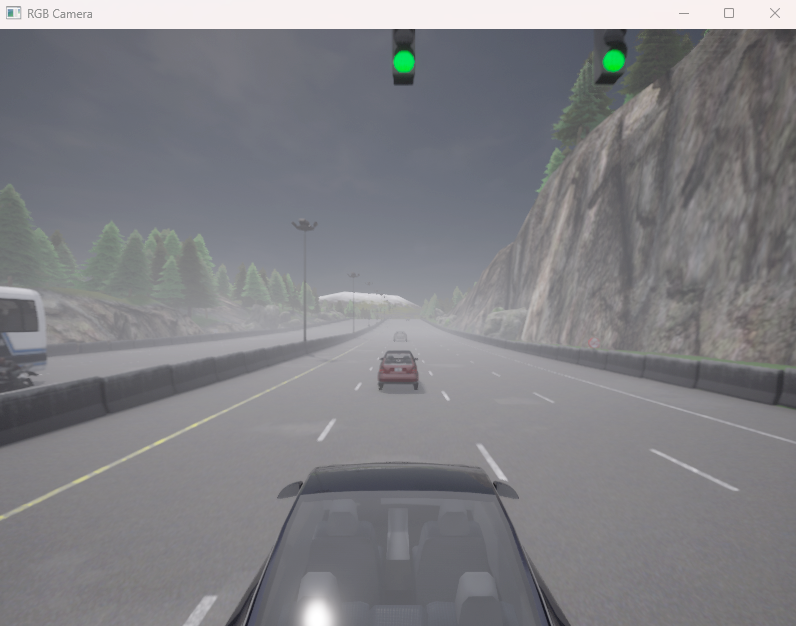
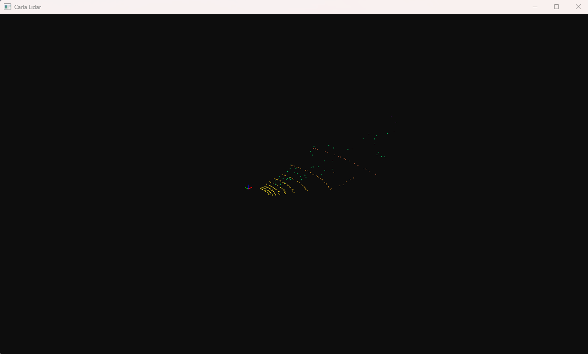

# 3D LiDAR and Radar Visualization in CARLA

<p align="center">
  
  
</p>

## What it does

1. Connects to CARLA on the local machine through port 2000 and loads the Town04 map.
2. Spawns a Tesla Model 3 as the main vehicle.
3. Spawns up to 30 more vehicles and turns on autopilot for the traffic.
4. Attaches three sensors to the main vehicle:
   - LiDAR: 100 m range, 16 channels, 10 Hz rotation, 50,000 points per second
   - Radar: 30° horizontal and vertical field of view, 10,000 points per second
   - RGB camera: placed behind and above the car
5. Converts the LiDAR and radar measurements into Open3D point clouds. LiDAR points are colored by intensity, radar points by velocity.
6. Shows the camera feed in an OpenCV window and the point clouds in an Open3D window.
7. Stops and destroys the sensors and vehicles when the loop ends.

## Data processing

LiDAR packets come from CARLA as groups of four values (x, y, z, intensity). The notebook splits them into 3D coordinates and intensity, and flips the lateral (y) axis so the cloud matches Open3D's orientation.

Radar detections come as depth, azimuth and altitude, which are converted to x, y, z coordinates. The velocity of each detection is used for the color mapping.

The camera callback turns each image packet into an array that OpenCV can display.

The Open3D window also shows a coordinate frame, and LiDAR and radar are kept as two separate point clouds.

## Requirements

- CARLA Simulator
- Python 3
- CARLA Python API (must match your simulator version)
- NumPy
- OpenCV
- Open3D
- Matplotlib
- Jupyter Notebook, or PyCharm in Scientific mode

```
pip install numpy opencv-python open3d matplotlib
```

## Running the notebook

1. Start the CARLA server and leave it on the default port, 2000.
2. Open `3D-LIDAR-RADAR.ipynb`.
3. Run the cells in order and wait for the world, vehicles and sensors to load.
4. Watch the OpenCV camera window and the Open3D point cloud window.
5. Press `q` in the camera window to stop. This also cleans up the sensors and vehicles.

## Performance

Sensor data can use a lot of CPU, GPU and RAM. Run the cells only once per session, and close or restart the CARLA world before setting the sensors up again. The LiDAR settings in the notebook are already reduced, but how well it runs still depends on your computer and the CARLA rendering settings.

If your system gets unstable, stop the notebook kernel and CARLA first. Then lower the number of traffic vehicles and the LiDAR point rate, channel count or rotation frequency before trying again.

Note: if you interrupt the visualization cell instead of pressing `q`, the cleanup code doesn't run, so restart CARLA or reload the map.
